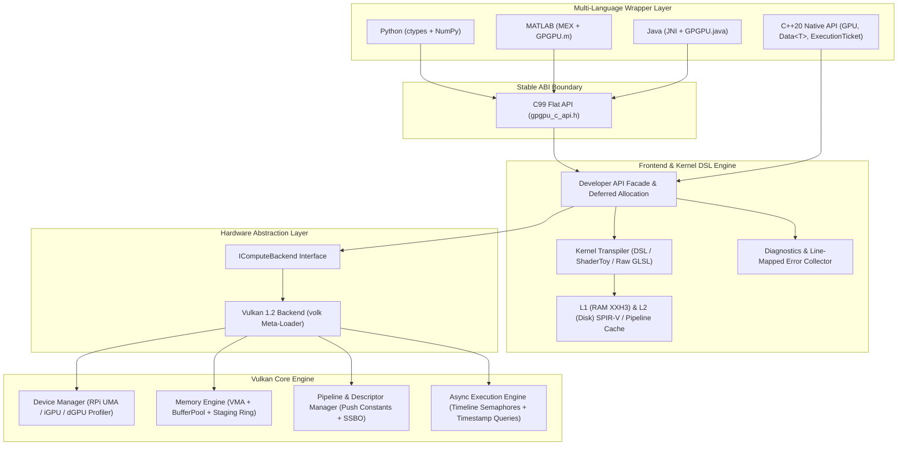

# GPGPU.VULKAN

**High-Performance, Zero-Boilerplate General-Purpose GPU Computing Built on Vulkan 1.2**

[](https://en.cppreference.com/w/cpp/20)
[]()
[](https://www.khronos.org/vulkan/)
[]()
[]()

**GPGPU.VULKAN** eliminates the hundreds of lines of boilerplate typically required by low-level graphics/compute APIs (`VkInstance`, `VkDescriptorSet`, `VkPipelineBarrier`, `VkCommandBuffer`, manual workgroup math, and memory staging) and replaces them with an intuitive, 5-line developer experience—without sacrificing native Vulkan 1.2 hardware performance.

Designed to scale seamlessly from embedded **Raspberry Pi (VideoCore VI/VII V3DV)** boards and **integrated laptop GPUs (Intel Iris/Arc, AMD APU)** to high-end **discrete workstations (NVIDIA RTX, AMD Radeon RX)**, GPGPU.VULKAN automatically adapts its memory transfer strategies, workgroup topologies, and shader pipelines to the underlying silicon.

---

## Table of Contents

- [Key Features](#key-features)
- [Architecture Overview](#architecture-overview)
- [Hardware-Adaptive Execution Matrix](#hardware-adaptive-execution-matrix)
- [Quick Start (5-Minute Integration)](#quick-start-5-minute-integration)
  - [Deployment Package Structure](#deployment-package-structure)
  - [CMake Integration](#cmake-integration)
  - [Direct Command-Line Compilation](#direct-command-line-compilation)
  - [Hello GPU Example](#hello-gpu-example)
- [Core Capabilities & Developer Guide](#core-capabilities--developer-guide)
  - [1. Device Discovery & Intelligent GPU Selection](#1-device-discovery--intelligent-gpu-selection)
  - [2. Memory Management, Data Types & Buffer Pooling](#2-memory-management-data-types--buffer-pooling)
  - [3. 1D, 2D, and 3D Compute Dispatch](#3-1d-2d-and-3d-compute-dispatch)
  - [4. Kernel Writing Modes: DSL, ShaderToy & Raw GLSL](#4-kernel-writing-modes-dsl-shadertoy--raw-glsl)
  - [5. Runtime Dynamic Kernels & L1/L2 Pipeline Caching](#5-runtime-dynamic-kernels--l1l2-pipeline-caching)
  - [6. GPU-Agnostic Interpolation (`nearest`, `linear`, `cubic`)](#6-gpu-agnostic-interpolation-nearest-linear-cubic)
  - [7. Asynchronous Execution, Callbacks & Zero-Copy Kernel Chaining](#7-asynchronous-execution-callbacks--zero-copy-kernel-chaining)
  - [8. Non-Crashing Error Handling & Line-Accurate Diagnostics](#8-non-crashing-error-handling--line-accurate-diagnostics)
- [Multi-Language Bindings (C99, Python, MATLAB, Java)](#multi-language-bindings-c99-python-matlab-java)
- [ShadertoyOnVulkan Desktop Studio](#shadertoyonvulkan-desktop-studio)
- [Building from Source (Standalone & Cross-Platform)](#building-from-source-standalone--cross-platform)

---

## Key Features

- **Zero Vulkan Boilerplate:** Write only the core mathematical expression (`kernel(coord) { outputData[coord] = cos(varNameIn[coord]); }`). Storage buffers (SSBOs), push constants, workgroup sizes, and out-of-bounds guards are generated automatically.
- **In-Memory GLSL-to-SPIR-V Compiler:** Powered by embedded `glslang` and `SPIRV-Tools` (validator & performance optimizer). Compiles shaders directly in RAM with zero temporary disk I/O.
- **Two-Tier `XXH3_64` Pipeline Cache:**
  - **L1 RAM Cache:** ~20 nanosecond lookup for repeated kernel executions in hot loops.
  - **L2 Disk Cache:** Persists compiled `.spv` binaries and `VkPipelineCache` across application restarts (`< 0.5 ms` cold-start load).
- **Hardware-Aware Memory Engine (VMA):**
  - **Unified Memory Architecture (UMA) Zero-Copy:** Detects Raspberry Pi (`V3DV`), Intel/AMD iGPUs, and uses persistent `HOST_VISIBLE | HOST_CACHED` mapping with direct `memcpy`—completely bypassing staging buffers.
  - **Discrete GPU (dGPU) Staging Ring-Buffer:** Uses `DEVICE_LOCAL` VRAM paired with cached staging ring-buffers and DMA transfers for maximum PCIe bandwidth.
  - **Automatic `BufferPool` & Deferred Allocation:** Output buffers created without dimensions (`gpu.createData("out")`) automatically size themselves on first `run()` and recycle freed allocations in `0 ns`.
- **Zero-Copy Kernel Chaining:** Chained kernels keep intermediate buffers resident in VRAM, automatically inserting `VkBufferMemoryBarrier` synchronization without round-tripping to host RAM.
- **Strict No-Crash Policy:** Never calls `abort()`, `assert()`, or leaks unhandled exceptions across ABI boundaries. Missing drivers, invalid device names, or GLSL syntax errors are cleanly captured and exposed via `gpu.hasError()` with `#line 1` mapped compiler diagnostics.
- **Zero External SDK Required to Deploy:** Pre-compiled binaries and pure C++20/C99 headers (`deploy/`) work out-of-the-box without requiring the Vulkan SDK installed on target machines.

---

## Architecture Overview

GPGPU.VULKAN is structured into four decoupled layers, anchored by a stable C99 ABI boundary (`gpgpu_c_api.h`) that powers all language bindings:



---

## Hardware-Adaptive Execution Matrix

At initialization (`GPU()`), GPGPU.VULKAN inspects `VkPhysicalDeviceProperties`, `VkPhysicalDeviceMemoryProperties`, and subgroup capabilities to classify the target hardware into one of three execution profiles:

| Parameter / Strategy    | Profile 1: Embedded / SBC (`Raspberry Pi 4/5 V3DV`)                      | Profile 2: Integrated GPU (`Intel Iris/Arc, AMD APU`)                          | Profile 3: Discrete GPU (`NVIDIA RTX, AMD Radeon RX`)                           |
|:----------------------- |:------------------------------------------------------------------------ |:------------------------------------------------------------------------------ |:------------------------------------------------------------------------------- |
| **Memory Architecture** | Full UMA (Shared System RAM)                                             | Full UMA (Shared System RAM)                                                   | Dedicated VRAM (`DEVICE_LOCAL`) + PCIe Bus                                      |
| **Transfer Strategy**   | **Zero-Copy** (`HOST_VISIBLE \| HOST_CACHED` persistent map, no staging) | **Zero-Copy** (`HOST_VISIBLE \| HOST_COHERENT \| HOST_CACHED` direct `memcpy`) | **Staging Ring-Buffer + DMA Copy** (`VK_QUEUE_TRANSFER_BIT` $\rightarrow$ VRAM) |
| **1D Workgroup Size**   | `(64, 1, 1)` (64 threads)                                                | `(256, 1, 1)` (256 threads)                                                    | `(256, 1, 1)` (256 threads)                                                     |
| **2D Workgroup Size**   | `(8, 8, 1)` (64 threads)                                                 | `(16, 16, 1)` (256 threads)                                                    | `(16, 16, 1)` (256 threads)                                                     |
| **3D Workgroup Size**   | `(4, 4, 4)` (64 threads)                                                 | `(8, 8, 4)` (256 threads)                                                      | `(8, 8, 4)` (256 threads)                                                       |
| **FP64 (`double`)**     | Runtime capability check                                                 | Hardware-dependent (`shaderFloat64`)                                           | Supported (`GL_ARB_gpu_shader_fp64`)                                            |

---

## Quick Start (5-Minute Integration)

### Deployment Package Structure

To integrate GPGPU.VULKAN into any existing project, copy the self-contained `deploy/` directory. No global Vulkan SDK installation is required:

```text
deploy/
├── CMakeLists.txt                  # Ready-to-use CMake target (gpgpu::static / gpgpu::shared)
├── build_linux.sh                  # Native build script for Linux & Raspberry Pi
├── include/gpgpu/
│   ├── gpgpu.hpp                   # C++20 Developer API (GPU, Data<T>, ExecutionTicket)
│   ├── gpgpu_c_api.h               # C99 Flat ABI for FFI bindings
│   ├── types.hpp                   # Dim3, DataType, Interpolation, GPUError, DeviceInfo
│   └── backend_interface.hpp       # Abstract compute backend interface
├── lib/
│   ├── windows-x64/                # Windows x86_64 binaries (.dll, .dll.a, _static.a)
│   ├── linux-x86_64/               # Linux 64-bit Intel/AMD shared library (.so)
│   ├── linux-x86/                  # Linux 32-bit Intel/AMD shared library (.so)
│   ├── linux-aarch64/              # Raspberry Pi 4/5 64-bit ARM (V3DV) (.so)
│   └── linux-armhf/                # Raspberry Pi 2/3/4 32-bit ARM (armv7l) (.so)
└── bindings/
    ├── python/gpgpu.py             # Zero-dependency Python wrapper (ctypes + NumPy)
    ├── matlab/                     # MATLAB MEX source & GPGPU.m class wrapper
    └── java/                       # Java JNI wrapper (GPGPU.java)
```

### CMake Integration

```cmake
cmake_minimum_required(VERSION 3.20)
project(MyGPUApp LANGUAGES CXX)

set(CMAKE_CXX_STANDARD 20)
add_subdirectory(deploy)

add_executable(my_gpu_app main.cpp)

# Link statically (single standalone executable, no DLLs needed):
target_link_libraries(my_gpu_app PRIVATE gpgpu::static)

# Or link dynamically:
# target_link_libraries(my_gpu_app PRIVATE gpgpu::shared)
```

### Direct Command-Line Compilation

```bash
# Static linking (self-contained binary):
g++ main.cpp -std=c++20 -O3 -Ideploy/include -Ldeploy/lib -lgpgpu_vulkan_static -o app

# Dynamic linking:
g++ main.cpp -std=c++20 -O3 -Ideploy/include -Ldeploy/lib -lgpgpu_vulkan -o app
```

### Hello GPU Example

```cpp
#include <gpgpu/gpgpu.hpp>
#include <iostream>
#include <vector>

int main() {
    using namespace gpgpu;

    // 1. Automatically select the highest-scoring GPU (dGPU > iGPU > SBC)
    GPU gpu;

    // 2. Upload input data to the GPU under the shader variable name "varNameIn"
    std::vector<float> hostInput = {0.0f, 0.5f, 1.0f, 1.5707963f, 3.1415926f};
    auto remoteIn = gpu.createData("varNameIn", hostInput);

    // 3. Declare output buffer (Deferred Allocation: automatically sized during run())
    auto remoteOut = gpu.createData("outputData");

    // 4. Define the compute kernel (semicolons and boilerplate are optional)
    gpu.kernel("kernel(coord) { outputData[coord] = cos(varNameIn[coord]) }");

    // 5. Execute across 5 elements
    gpu.run(5);

    // 6. Retrieve results back to host RAM
    std::vector<float> hostOutput = remoteOut.get();

    for (size_t i = 0; i < hostOutput.size(); ++i) {
        std::cout << "cos(" << hostInput[i] << ") = " << hostOutput[i] << "\n";
    }

    return 0;
}
```

---

## Core Capabilities & Developer Guide

### 1. Device Discovery & Intelligent GPU Selection

Enumerate all Vulkan-capable devices on the system and instantiate `GPU` automatically, by index, or by case-insensitive substring match:

```cpp
// Enumerate hardware
for (const auto& dev : gpgpu::GPU::devices()) {
    std::cout << "[" << dev.index << "] " << dev.name
              << " | VRAM: " << (dev.totalMemoryBytes / (1024 * 1024)) << " MB"
              << " | UMA: " << (dev.isUnifiedMemory ? "Yes" : "No") << "\n";
}

gpgpu::GPU gpuAuto;             // Automatic scoring: Discrete (+10000) > Integrated (+5000) > CPU fallback
gpgpu::GPU gpuIndex(0);         // Select device at index 0
gpgpu::GPU gpuName("RTX 3060"); // Case-insensitive substring match ("Intel", "Radeon", "V3D", etc.)

auto caps = gpuAuto.capabilities();
std::cout << "Subgroup Size: " << caps.subgroupSize
          << " | FP64 Support: " << caps.supportsFloat64 << "\n";
```

### 2. Memory Management, Data Types & Buffer Pooling

`gpu.createData` is strongly typed and supports scalar, integer, and vector types mapped directly to `std430` GLSL storage buffers:

| C++ Type                        | GLSL Type                           | Size              |
|:------------------------------- |:----------------------------------- |:----------------- |
| `float` (default)               | `float`                             | 4 Bytes           |
| `double`                        | `double` (`GL_ARB_gpu_shader_fp64`) | 8 Bytes           |
| `int32_t` / `uint32_t`          | `int` / `uint`                      | 4 Bytes           |
| `int16_t` / `uint16_t`          | `int16_t` / `uint16_t`              | 2 Bytes           |
| `int8_t` / `uint8_t`            | `int8_t` / `uint8_t`                | 1 Byte            |
| `gpgpu::vec2` / `vec3` / `vec4` | `vec2` / `vec3` / `vec4`            | 8 / 12 / 16 Bytes |
| `gpgpu::ivec2` / `ivec4`        | `ivec2` / `ivec4`                   | 8 / 16 Bytes      |

**Zero-Allocation Updates & Readbacks:**

```cpp
std::vector<float> data(10000, 1.0f);
auto buf = gpu.createData("data", data);

// Update existing GPU buffer in-place without reallocating VRAM
data[0] = 42.0f;
buf.set(data);

// Read back into a pre-allocated host span/vector with zero heap allocations
std::vector<float> preallocated(10000);
buf.getTo(preallocated);
```

Disposed or resized buffers are returned to an internal 256-byte-aligned `BufferPool` free-list, enabling `0 ns` Vulkan memory reuse for subsequent allocations.

### 3. 1D, 2D, and 3D Compute Dispatch

The dimensionality of `gpu.run(...)` automatically determines the GLSL type of `coord` and injects safe boundary clamping:

| Dispatch Call            | Mode              | GLSL `coord` Type | Indexing Behavior                                                      |
|:------------------------ |:----------------- |:----------------- |:---------------------------------------------------------------------- |
| `gpu.run(1000000)`       | 1D Array          | `int`             | `buf[coord]` $\rightarrow$ `0 .. 999999`                               |
| `gpu.run(800, 600)`      | 2D Matrix / Image | `ivec2`           | `buf[coord]` $\rightarrow$ `coord.y * 800 + coord.x`                   |
| `gpu.run(100, 100, 100)` | 3D Volume / Voxel | `ivec3`           | `buf[coord]` $\rightarrow$ `(coord.z * 100 + coord.y) * 100 + coord.x` |

Non-multiple dimensions (such as `800 x 600` with `16 x 16` workgroups) are handled safely via automatic `gl_GlobalInvocationID` bounds checks—preventing out-of-bounds memory writes.

### 4. Kernel Writing Modes: DSL, ShaderToy & Raw GLSL

`gpu.kernel(...)` automatically detects and compiles three distinct shader formats:

1. **GPGPU DSL Mode (with optional helper functions):**

   ```cpp
   gpu.kernel(R"(
       float activate(float x) { return max(0.0, x); }
       kernel(coord) {
           outputData[coord] = activate(inputData[coord] * 2.0 - 1.0);
       }
   )");
   ```

2. **ShaderToy Compatibility Mode (`void mainImage`):**
   Paste ShaderToy pixel shaders directly. Uniforms (`iResolution`, `iTime`, `iTimeDelta`, `iFrame`, `iMouse`) are automatically bound via 64-byte Push Constants:

   ```cpp
   auto frameBuffer = gpu.createData<gpgpu::vec4>("outputData");
   gpu.kernel(R"(
       void mainImage(out vec4 fragColor, in vec2 fragCoord) {
           vec2 uv = fragCoord / iResolution.xy;
           vec3 col = 0.5 + 0.5 * cos(iTime + uv.xyx + vec3(0.0, 2.0, 4.0));
           fragColor = vec4(col, 1.0);
       }
   )");
   gpu.run(1280, 720);
   ```

3. **Raw GLSL 450 Compute Mode:**
   Any source starting with `#version` bypasses the transpiler and compiles directly through `glslang` for full manual control over bindings and shared memory.

### 5. Runtime Dynamic Kernels & L1/L2 Pipeline Caching

Kernels can be swapped dynamically at runtime without invalidating resident GPU buffers:

```cpp
gpu.kernel("kernel(coord) { outData[coord] = cos(inData[coord]); }");
gpu.run(N);

// Swap kernel on the fly using the exact same GPU buffers
gpu.kernel("kernel(coord) { outData[coord] = sin(inData[coord]); }");
gpu.run(N);
```

Every compiled pipeline is indexed by a 64-bit `XXH3` hash of the kernel source, dispatch dimensionality, workgroup layout, and bound variable signatures. Repeated calls hit the **L1 RAM cache in ~20 ns**, while cold starts load pre-compiled SPIR-V from the **L2 disk cache** (`%LOCALAPPDATA%/gpgpu_vulkan/cache/` on Windows, `~/.cache/gpgpu_vulkan/` on Linux).

### 6. GPU-Agnostic Interpolation (`nearest`, `linear`, `cubic`)

Because embedded GPUs (such as Raspberry Pi's VideoCore) lack hardware `VK_FILTER_CUBIC_EXT` support across arbitrary data types, GPGPU.VULKAN injects analytical GLSL interpolation functions directly over SSBOs. Indexing a buffer with floating-point coordinates (`srcImg[vec2(x, y)]`) automatically evaluates **Nearest-Neighbor**, **Bilinear/Trilinear**, or **Catmull-Rom Bicubic** weights identically across all hardware:

```cpp
// 4x4 input image
std::vector<float> smallImg = { /* 16 floats */ };
auto srcImg = gpu.createData("srcImg", smallImg, gpgpu::Dim3(4, 4), "cubic");
auto dstImg = gpu.createData("dstImg");

// Upscale 2x to 8x8 using analytical Catmull-Rom bicubic interpolation
gpu.kernel(R"(
    kernel(coord) {
        vec2 uv = vec2(coord) * 0.5;
        dstImg[coord] = srcImg[uv];
    }
)");
gpu.run(8, 8);
```

### 7. Asynchronous Execution, Callbacks & Zero-Copy Kernel Chaining

Use `runAsync()` to overlap CPU work with GPU execution, register non-blocking `onDone` callbacks backed by Vulkan Timeline Semaphores, or chain multiple kernels in VRAM without host readbacks:

```cpp
auto bufA = gpu.createData("bufA", std::vector<float>(1'000'000, 2.0f));
auto bufB = gpu.createData("bufB"); // Intermediate buffer stays exclusively in VRAM
auto bufC = gpu.createData("bufC"); // Final output buffer

// Step 1: Asynchronous dispatch
gpu.kernel("kernel(coord) { bufB[coord] = bufA[coord] * 3.0; }");
gpu.runAsync(1'000'000);

// Step 2: Automatic VkBufferMemoryBarrier inserted; bufB is never copied to CPU
gpu.kernel("kernel(coord) { bufC[coord] = sqrt(bufB[coord]) + 1.0; }");
auto ticket = gpu.runAsync(1'000'000);

ticket.onDone([&]() {
    std::cout << "Pipeline finished on GPU in "
              << ticket.elapsedMilliseconds() << " ms\n";
});

ticket.wait();
auto finalResult = bufC.get(); // Only the final result crosses PCIe
```

### 8. Non-Crashing Error Handling & Line-Accurate Diagnostics

The transpiler injects `#line 1` immediately prior to user kernel code so compiler diagnostics report exact user line numbers rather than generated header offsets:

```cpp
gpu.kernel("kernel(coord) { outData[coord] = undefined_symbol * 2.0; }");
gpu.run(100);

if (auto err = gpu.hasError()) {
    std::cerr << "Error: " << err->message << "\n"
              << "Shader Log:\n" << err->shaderLog << "\n";
    gpu.clearError();
}
```

---

## Multi-Language Bindings (C99, Python, MATLAB, Java)

### Python (`ctypes` + `NumPy`)

Zero `pip` dependencies or C compiler required. Automatically detects OS and CPU architecture (`x86_64`, `aarch64`, `armv7l`) to load the appropriate shared library:

```python
import sys
sys.path.append("deploy/bindings/python")
from gpgpu import GPU

with GPU(0) as gpu:
    remote_in  = gpu.createData("varNameIn", [0.0, 0.5, 1.0, 1.5707963])
    remote_out = gpu.createData("outputData")

    gpu.kernel("kernel(coord) { outputData[coord] = cos(varNameIn[coord]); }")
    gpu.run(4)

    print("Result:", remote_out.get())  # Returns NumPy ndarray if installed, or Python list
    print(f"Hardware Time: {gpu.lastKernelTimeMs():.3f} ms")
```

### C99 Flat ABI (`gpgpu_c_api.h`)

```c
#include <gpgpu/gpgpu_c_api.h>
#include <stdio.h>

int main(void) {
    GPGPU_Context ctx = gpgpu_create_auto();
    float input[4] = {0.0f, 0.5f, 1.0f, 1.5707963f};

    GPGPU_Data inBuf  = gpgpu_create_data(ctx, "varNameIn", input, 4, GPGPU_DTYPE_FLOAT32, GPGPU_INTERP_NONE);
    GPGPU_Data outBuf = gpgpu_create_data(ctx, "outputData", NULL, 0, GPGPU_DTYPE_FLOAT32, GPGPU_INTERP_NONE);

    gpgpu_set_kernel(ctx, "kernel(coord) { outputData[coord] = cos(varNameIn[coord]); }");
    gpgpu_run(ctx, 4, 1, 1);

    float output[4] = {0};
    gpgpu_data_get(outBuf, output, 4);

    gpgpu_data_destroy(inBuf);
    gpgpu_data_destroy(outBuf);
    gpgpu_destroy(ctx);
    return 0;
}
```

### MATLAB (`GPGPU.m` & MEX)

```matlab
gpu = GPGPU(0);
A = single(linspace(0, pi, 1000));

remoteIn  = gpu.createData('varNameIn', A);
remoteOut = gpu.createData('outputData');

gpu.kernel('kernel(coord) { outputData[coord] = cos(varNameIn[coord]); }');
gpu.run(1000);

B = remoteOut.get();
gpu.dispose();
```

### Java (`GPGPU.java` & JNI)

```java
import com.gpgpu.GPGPU;

public class Main {
    public static void main(String[] args) {
        try (GPGPU gpu = new GPGPU(0)) {
            float[] input = new float[]{0.0f, 0.5f, 1.0f, 1.5707963f};
            GPGPU.Data inData  = gpu.createData("varNameIn", input);
            GPGPU.Data outData = gpu.createData("outputData");

            gpu.kernel("kernel(coord) { outputData[coord] = cos(varNameIn[coord]); }");
            gpu.run(input.length);

            float[] output = outData.get();
        }
    }
}
```

---

## Building from Source (Standalone & Cross-Platform)

All third-party dependencies (`Vulkan-Headers`, `volk`, `VulkanMemoryAllocator`, `glslang`, `SPIRV-Headers`, `SPIRV-Tools`, `xxHash`, `spdlog`, `googletest`, `benchmark`) are vendored locally under `external/` for reproducible offline builds.

### Windows (PowerShell)

```powershell
.\build.ps1 # for .dll files

.\build_cross_linux.ps1 # for .so files (cross compile) 
```

### Linux & Raspberry Pi (Debian / Ubuntu / Raspberry Pi OS)

```bash
sudo apt update && sudo apt install -y build-essential cmake ninja-build libvulkan-dev mesa-vulkan-drivers
./build.sh
```
